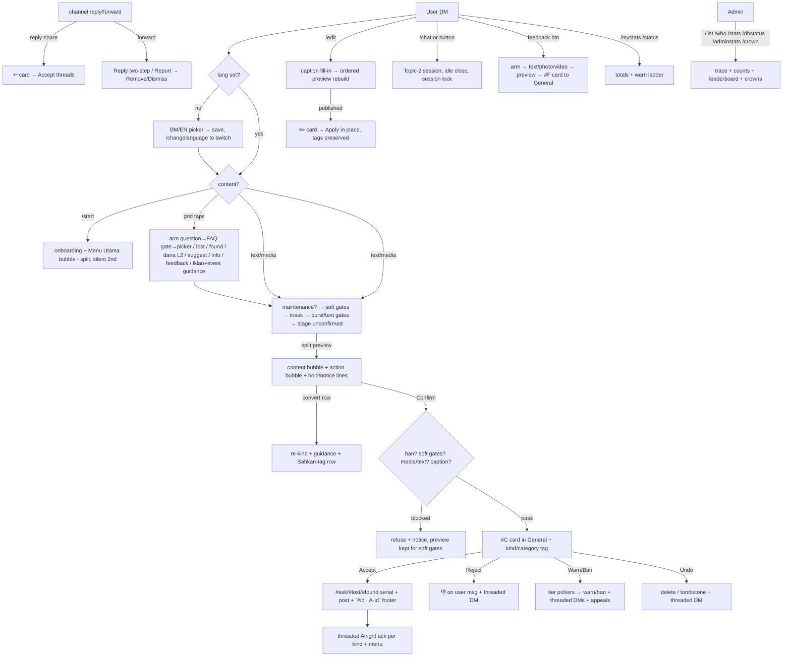

# Just_arobot — feature list (`bot/@Just_arobot/`; `@`-prefixed per-bot folders)

Test bot `@Just_arobot` → promotes to live `@unijaconfession_chatbot` (same code,
different link; needs the live token — BotFather transfer doesn't exist).
Owner posted the old/new-bot teaser; users stay on the old typo'd bot for now.
Inbox: private group `-1002435146176` General topic. Channel:
`Test Channel` `-1001267775431`. Full history: `plan.md §10`.
Live proof: `stress_test.md`. Current: `V 1.0.24 051126`.

## Flow

## Onboarding + language

- First `/start` → BM/EN picker (`users.lang`, migrate applied); later `/start`
  skips to onboarding; `/changelanguage` re-opens it. Existing rows default `ms`.
- Malay 5-section `/start` (prohibitions + event/dana pointers, FAQ pointer,
  how-to-send, privacy-as-resend, closing), personalized `Hi {name}`, section
  dividers (`§§` markers → rich dividers / `──` lines). Split bubbles: onboarding
  text first, Menu Utama second (silent).
- **Menu Utama / Main Menu** (centered-table header both shapes): Confession Biasa /
  Tanya Soalan + Lost & Found / Iklan Niaga + Promote Event/Program + Cari Dana /
  Suggest sharing + Info Sharing / divider / Chat + Channel (when URL set) +
  Rules / Bantuan + Tutorial / Bot Feedback. Bantuan = `/help` text, Tutorial =
  page 1. `grid_help`/`grid_tut` reuse the command sends.
- All user-DM strings live in `tgcloud/lib/strings.js` (`STR.ms` + `STR.en`,
  189 keys, parity-checked); per-user locale threading, global `LANG` fallback.
  Admin group side stays English; ban/warn voice still English (deferred slice).
- `/tutorial` (DM 4-step + group admin 4-step); step 2 lists all kinds, step 3
  links the reply guide (46470) and the reject list (46990), plus the
  maintenance/midnight note. `/changelog` (version + recent changes).
- Cancel → preview deleted + compact menu (shared grid helper). Confirm → Alright
  ack per kind + menu. **Every Batal and `/cancel*` lands on the menu**
  (incl. no-draft branches).

## Confession intake (confession / `#ask` / `#lost` / `#found` / `#cariandana`+`#dermakilat` / `#suggest` / `#info`)

- Text / photo / video / voice / sticker / document (1 per message);
  `video_note` / animation refused. Photo/video/document require captions
  (Confirm gate + staging hold notice + edit-detect fill); voice nudged.
- Sender headers stripped — re-sent, never forwarded.
- **Split preview**: pure-content bubble + labeled action bubble
  (`Mesej diatas ialah *…*` + notes + rows). Confirm/Batal (+ green/red rich
  styles), always-on convert row (`❓ 🔍 📦` + separator pill), chat shortcut
  on heuristic hit (question/lost/found/chat detectors, suggestion-only).
- **FAQ gate** (Tanya Soalan): interstitial + 15s lazy pause → L1 category
  picker (Makan/Sewa/Servis/Barang/Tempat/Tumpang/Bas/Lain) → L2 sub-pickers
  (Servis/Tempat/Bas) → guided prompt per leaf; link branches self-serve
  (campus map, bus-stop page); Skip = bare `#ask`; back-to-categories on every
  prompt; mid-picker typing gets a nudge, nothing stages. Category saved
  (`ask_cat`/`ask_sub`) → card tag + `#ask` lead (edits preserve it).
- **Soft gates** (hold + clear-or-cancel notice, preview kept on blocked
  Confirm, Batal reuses `cancelconf`, audit rows):
  - reply-prefix (`rpl_cleared`): `r:/rep:/reply:` colon-or-dash line-start,
    text + captions, clear survives edits;
  - group-link (`grp_cleared` default 1): `t.me/` + `chat.whatsapp.com/`
    detected on raw text pre-mask, flag-only Confirm, edits re-hold but never
    auto-release (stale buttoned notices), own-channel refs excluded.
- Gates at Confirm: ban, soft gates, 4 media/day, 5 texts/hour + 20/day
  (rolling), caption-required.
- **Maintenance mode** (`/maintenance [on|off]`, owner-only silent, `meta`
  switch): new staging paused with a BM/EN notice; review side + EXEMPT run on.
- **Midnight mode** (clock-auto 12–7am MYT + `/midnight [on|off|auto]` override):
  staging unaffected, 🌙 notice on preview notes + post-Confirm ack.
- Contact auto-mask: emails + URLs always (`[hidden]`, card `stripped: contact`);
  **usernames + phones allowed** (owner call) with `MASK_MENTIONS`/`MASK_PHONES`
  revert switches. Kill switches `MASK_CONTACTS` / `TEXT_LIMITS` / `DRIP_FEED`.
- **Ad-keyword nudge** (preview line only, blocks nothing): iklan/sewa word lists
  + price+goods rule; skipped for declared `suggest`/`dana`; copy tuned to
  student sellers (selling-ad/house-rental hunt, empty slots).
- Kinds: `kind` column (confession/question/lost/found/dana/suggest/info);
  per-kind serials for ask/lost/found (`kind_seq` + unique index, race-safe
  retry); dana/suggest/info are bare-tag (`NO_SERIAL` set). Dana L2 subtypes
  (program/kilat → `askSub`): shared `#cariandana` vs `#dermakilat` leads,
  distinct cards; mid-pick nudge; back-to-L2/menu.
- Arm intents (`pending_intents` states) for reply/question/faq/lost/found/dana/
  suggest/info/feedback with `/cancelreply|/cancelquestion|/cancellostfound|/canceldana|/cancelsuggest|/cancelinfo|/cancelfeedback`;
  arm DMs die on cancel (`srcMsgId`); session lock blocks new-flow taps mid-chat;
  arming switches (never stacks) with notices; cancels are honest + menu-bound.
- Burst guard (3 msgs/min refused at staging) + tap guard (10 taps/min via
  `hits` table, notice throttled); owner + admins bypass; chat slow-mode removed.
- Caption fill-in (`handlers/edited_message.js`): staged edits sync text/caption
  + ordered preview rebuild via `action_msg_id` (rich-first, never edit-rich);
  threaded ack; hold/nudge notices tracked in `notice_ids`, die on
  Confirm/Cancel.

## Anonymity model

- **A-id** (`A0001…`, lazy MAX+1, unique) on all group surfaces — raw tg_id never
  leaves the DB except owner-only `/who` (id, A-id, alias, `#C`). Legacy
  `U-xxxx` aliases still resolve. (The `<tgId>-<A-id>` display was reverted.)
- Channel posts end with `#<msgId> · A-id` (message-id number, entities-based
  spoiler on the A-id; stamped second-pass, `NUM_RESERVE` caption holdback;
  edits recompute it from `channelMessageIds[0]`).
- `/who` + `/list` (super-admin DM; `/list` also group-admins): totals + `#C`
  history with status sections, 30/page, Seterusnya/Kembali, stateless cursor.

## Admin queue (single General topic, `#C` counter shared)

- Cards: confession / `↩️ Reply` / `🚩 Report` / `✏️ Edit` / `📨 Appeal #A`,
  `❓/🔍/📦/💰/💡/📣` kind tags, question category, dana subtype, `👤 A-id`.
  First-tap-wins; re-tap idempotent answers.
- **Accept** → post + `#id · A-id` footer + `see the post` link (URL form
  auto-resolved) + ` · #id` on the card, `Undo` row, threaded per-kind user DM.
  Republish path for undone cards.
- **Reject** → 👎 reaction on the user's message + threaded DM.
- **Drip-feed parked OFF** (approval-by-hand paces enough): queue code, `/flush`,
  queued counts remain for later.
- **Undo** → delete, tombstone fallback + threaded DM. Every card stamped
  `by <admin>` (mention).
- **Threaded verdicts** (`verdictDM`): every verdict DM (approve/queue/reject/
  warn/ban/undo/edit/report/apply) + card swipe-replies thread under the user's
  original (plain fallback); appeals stay plain (no submission link).
- Owner-only mass mention (`!all` everyone, `!active` on-duty greens, silent for
  others, lands in General, no cooldown); `/onduty` + `/dutyroster` (stale flags).
- `/adminstats` (readable EN buckets, median triage, 7d/30d/all switcher,
  crown-holder 👑/⚡ markers) + `/recent` + paged `/oldest` + mod/card notes
  (`/note`/`/unnote`/`/notes`, threaded card notes, 3-leg reply resolution).
- `/botstats` (`last_seen` + `dead` + `day_out`, dead-skipped sends);
  `/announce` (group + owner DM, sent/failed report).
- `/crown` (owner, silent otherwise): 30d most-actions + fastest-median (min 5,
  owner excluded) → single overall on double-win; bot-side honor only
  (Telegram titles need bot-promoted admins) — announcement + `crowns` table +
  `/adminstats` markers.
- `/maintenance` + `/midnight` (owner, silent otherwise): pause intake /
  midnight-notice override; both in autocomplete + `/help`.
- `/stats` (pending/queued), `/dbstatus` (table counts + status mix + range),
  `/unbutton` (strip dead keyboards), `/synccommands` (autocomplete scopes),
  `/richprobe` (rich-pipeline probe). `/ban` / `/unban` (reply-to-card or A-id/raw
  id, `@bot` suffix tolerated, quoted sends fall through to the A-id).

## Warn / ban ladder (per channel terms)

- `flood, other` → ringan (warn, 2nd = auto 7d, 3rd = forever);
  `spam, abuse` → sederhana (every warn + auto 20d, 2nd = forever);
  `nsfw, scam` → berat (instant forever, no warning, no appeal).
- 60-day rolling window (audit-derived); duration → tier-labeled reasons →
  alert review → Confirm/Back at every step.
- `/unban` wipes bans + warn slate. Appeals: `/appeal` → Accept (unban) / Reject;
  berat auto-rejected; 1 pending max; both sides notified.

## Replies / reports / reactions / edits / chat

- Admin swipe-reply on cards → anonymous relay (silent OK, unreachable notice
  with A-id, threaded under the submission). Channel reply-share + cross-chat
  "Reply in…" → threaded `↩️` cards.
- Forwards → Reply two-step (arm → type, `/cancelreply`) / Report (reasons →
  Remove/Dismiss, both sides notified).
- Copy-paste replies (`Rep:`/`r:` without the Reply feature) held by the
  reply-prefix soft gate + 46470 guide link.
- Reactions mirrored both ways (bot-mirrored, removals too, premium skipped).
- `/edit` → `✏️` card → in-place channel edit (tags re-attached, contacts
  re-masked, media swaps refused, gone-post guidance).
- Topic-2 sessions: user `/chat` / button / admin `/startchat` (busy cap 5,
  30-min idle close, opener markers mapped so reply-to-opener routes, unlinked
  replies get guidance instead of silence). Opener markers carry reply
  instructions + `✖ Close chat` (`endchat_`); `/startchat` + `/endadminsession`
  work from **every topic** (origin-thread answers, Topic-2 pointer link),
  reply-to-card resolves the author, Topic-2 slash never relays to users,
  unreachable openers noted on the marker.

## Bot feedback

- Grid `🛠️ Bot Feedback` → arm → text/photo/video → split preview → Sahkan posts
  `#F<id> 📩 Feedback · 👤 A-id · <version>` to General (never published);
  Batal + `armcancel:feedback` + `/cancelfeedback` all land on menu. Ban + burst
  gates; works during maintenance. Replies via existing `/startchat`.

## Admin access + audit

- Bot-admin = live group admins (`getChatAdministrators`, 60s cache) +
  `ADMIN_IDS` fallback. Every action writes `audit`. Anonymous-admin sends get
  no response (GroupAnonymousBot isn't an admin — send as yourself).
- Rich-vs-inline hybrid: rich-first for look-first surfaces (green/red styles,
  dividers, centered tables — each with plain fallback), pure inline where
  buttons mutate. Rich is platform-bound (dies on any tgcloud exit); inline is
  portable. `docs/rich-messages.md` remains the shape reference.

## Schema (all migrated clean)

- `notes` (+ UNIQUE rebuild via one-shot endpoint, since removed), `duty`,
  `day_out`, `users.{last_seen,dead}`, `submissions.{ask_cat,ask_sub,
  action_msg_id,notice_ids,rpl_cleared,grp_cleared}`, `crowns`, `meta`,
  `feedback`.
- New handlers: `edited_message.js` (caption fill-in). New lib: `changelog.js`.

## Versioning

- User-visible `VERSION` (`V <maj>.<min>.<patch> DDMMYY`) via `/changelog`
  (DM locale-aware, group English, both autocompletes); entries in
  `lib/changelog.js` (newest last, shown newest-first, last 5).
- Patch auto per slice · minor propose-confirm · major owner-only ·
  date refreshes on every touch. Full rules: `plan.md §11`.

## Parked / open

- Live promotion (needs live token pasted here — teaser posted, users on old bot;
  `bot/@BotName` folder convention agreed, split at promotion).
- `minta-link` detect (paused — needs owner's BM phrasing list).
- Reply templates finalized (14d/30d call: 14d; `/ban 1d` verified via typed path).
- `/faqsync` (Sheet "Unija FAQ", 27 seeded rows → DB replica, unbuilt).
- Announce batching at scale. Ban/warn Malay voice. EN-locale test debt.
- Commit pending explicit ask (origin still `96857a0`).
