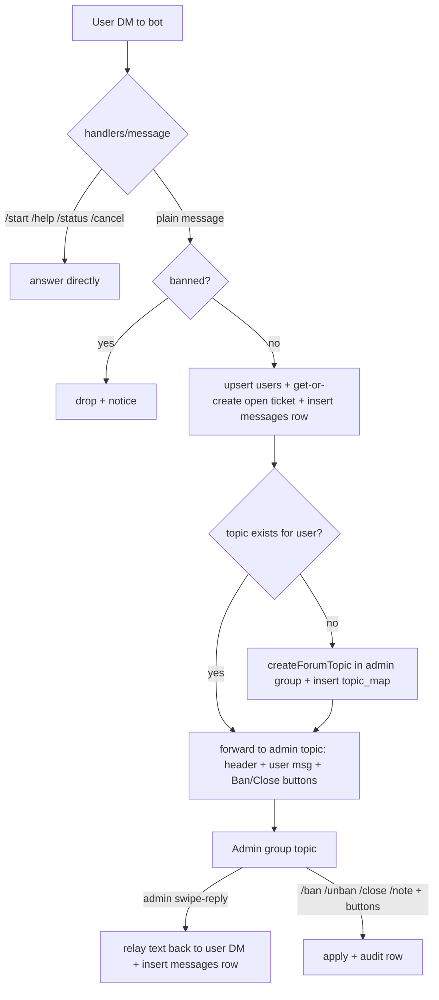

# plan.md — Just_arobot feedback inbox (Livegram-style)

## 1. Goal

Anonymous-ish feedback inbox: users DM the bot, admins triage and reply from a
private group with topics. Test on `@Just_arobot`, promote the same code to live
bot `@unijaconfession_chatbot` (different Telegram account, tgcloud/serverless
access pending).

## 2. Bots and accounts

| Role | Bot | Account | State |
|------|-----|---------|-------|
| Test | `@Just_arobot` | this account | tgcloud link available — build + verify here |
| Live | `@unijaconfession_chatbot` | other account (owner-controlled) | serverless access NOT yet granted — no `login`/`push` until then |

Promotion = same code, different link: `npx tgcloud login` to test bot → push +
migrate + verify; later `login` to live bot → push + migrate + verify. No code
fork. Live group ID / topic set / admin IDs differ per environment (never
hardcode — see §7).

## 3. Hosting (decision)

This folder follows the repo pattern: **tgcloud** (V8 isolate, `push` deploys,
`migrate` syncs schema, webhook managed). Siblings: `bot/ask_the_robot/`.

Options considered:
- **tgcloud (chosen):** zero ops, matches repo ritual, built-in `db`/`api`.
  Constraint: no filesystem, no npm at runtime — so no sqlite file; the
  platform tables are the fast store, external DB via `fetch` only if needed.
- **Vercel serverless:** webhook route, 60s kill, cron daily-only. sqlite only
  as disposable `/tmp` cache (wiped on cold start), Neon/Supabase as truth.
- **VPS:** only option with a real persistent sqlite file. Own uptime/backups.

External DB (Neon vs Supabase) deferred until after the flow is agreed. On
tgcloud the platform db covers v1; external attaches later via `fetch` without
rewriting handlers.

## 4. Flow — private group/topics inbox

Rules: one open ticket per user (v1). Ban checked before anything is stored as a
ticket message. Admin group is invite-only; bot must be admin with
`can_manage_topics`. Topic-per-user; fallback to single topic with `#T<ticket>`
headers if topics are disabled.

## 5. Commands

Public (user DM): `/start` (what the bot is + consent), `/help`, `/status`
(open/closed), `/cancel` (close own ticket), `/delete_my_data`. Anything else =
ticket message.

Admin (group topics only, allowlist IDs): swipe-reply = answer; `/ban <reason>`,
`/unban`, `/close`, `/note <text>` (internal, never relayed), `/broadcast`
(double-confirm), `/stats` (open tickets, msgs/24h). Buttons: `Ban`, `Close`
under each forwarded message (`ban:<userId>` / `close:<ticketId>`).

## 6. Schema (`tgcloud/schema.js`)

`users` (tg_id unique, banned flag) · `tickets` (user_id, status, topic_id) ·
`messages` (ticket_id, direction `in`/`out`, tg_message_id, text) · `topic_map`
(topic_id↔user_id, hot read path) · `audit` (admin actions). No FKs (runtime
has them off). Schema change → `push` reports, `migrate` applies.

## 7. Secrets and env (per bot link, never in git)

Bot token lives in the tgcloud link (`.tgcloud/`, gitignored), not in code.
Config that differs test↔live (admin group id, admin IDs, live username):
keep in a `tgcloud/lib/config.js` constant edited per `login` target, or an
endpoint-set table — decided at live-promotion time. Never commit tokens.

## 8. Test → live checklist

1. `cd bot/Just_arobot` + `npm install` (local CLI only).
2. `npx tgcloud login` → test `@Just_arobot`; `push`; `migrate`; `webhook` sync check.
3. Live-verify on test: `/start`, user msg → topic created → admin reply → user
   receives; `/ban` → blocked; `/close` → `/status` closed.
4. When live account gets serverless: `login` → `@unijaconfession_chatbot`;
   `push`; `migrate`; set group/admin config; repeat step 3 on live.
5. `deploy.py` mirrors `ask_the_robot` (`python deploy.py[--migrate]`).

## 9. Open items

- Admin group for test (id?) + admin allowlist.
- External DB need (v1 platform db likely enough — confirm after flow test).
- `/broadcast` scope (all users vs open-ticket users) + rate guard.
- Media/file support in relay (v1 text-first?).

## 10. TODO (confession-queue pivot, Nov 2026)

- [x] Single inbox topic queue (`-1002435146176`, topic General) + anonymous `#C` cards
- [x] Admin cards show numeric user id (`👤 <tg_id>`) — no clickable profile in group
- [x] Owner profile lookup in private chat only: DM `/who <user id>` (super-admin)
- [x] Album support DROPPED — every photo/video posts singly, immediately
- [x] Daily media limit: 1 photo/video per user per rolling 24h, text free
- [x] Limit exemptions: `EXEMPT_IDS` (owner + list) — paste extra ids to extend
- [x] Admin swipe-reply on card/content → relay to user DM (silent OK; unreachable posts id notice)
- [x] Reaction relay both ways (bot mirrors emoji set; removals mirror too)
- [x] Reactions on admin-reply DMs loop back to the admin's group message
- [x] Warn tiers per terms: flood/other→ringan (warn, 2nd=7d, 3rd=forever) · spam/abuse→sederhana (warn+20d, 2nd=forever) · nsfw/scam→berat (instant forever, no appeal) · /unban resets slate · terms URL in /help
- [x] Ban appeals: /appeal in DM → card with Accept(unban)/Reject · berat auto-rejected · 1 pending appeal max
- [x] 60-day warn window (WARN_WINDOW_DAYS; audit-derived counts; /who shows in-window)
- [x] Ban DM voice centralized (lib/moderation.js banNotice): temp/appealable/berat forms
- [x] /unban <user id> in group (reply-to-card still works; bare form shows usage)
- [x] Back buttons on all pickers (reason→duration→main row)
- [x] Tier labels on reason buttons (· ringan/sederhana/berat) + confirm step with alert review for warn/ban
- [x] Channel replies: reply-share → ↩️ queue card → Accept threads under post (gone-post guard)
- [x] Channel forwards → disambiguate (Reply / Report) via staged intents (reply = two-step: arm → type; /cancelreply aborts)
- [x] Reports: preset reason → 🚩 card with Remove (delete+tombstone, both sides notified) / Dismiss
- [x] Bot-admin = group admins live (getChatAdministrators, 60s cache) + ADMIN_IDS fallback
- [x] Confirm-before-send (unconfirmed staging + preview + Confirm/Cancel; gates at confirm)
- [x] A-id cutover (A0001… series, lazy MAX+1; group surface shows A-id; /who resolves A/raw/legacy)
- [x] Edit flow (reply-to-own-DM /edit → ✏️ card → Apply edits channel text/caption / Dismiss)
- [x] User-admin chat sessions (Topic 2 shared; /chat opens, plain DMs route, slow-mode 2min, 30min idle, cap 5; /endadminsession both sides; swipe-reply relay + chat_map)
- [x] Admin-initiated chat (/startchat by reply or A-id; skips busy cap; banned need /unban first)
- [x] Group identity format `<tgId>-<A-id>` (e.g. 7154716451-A0001) on cards, chat lines, notices
- [x] Channel posts carry spoiler A-id tag (entities-based; preserved through edits)
- [x] Reject button (decline without warn/ban; both sides stamped/notified)
- [x] Post hyperlinks (`see the post` on Published DMs + accept stamps; URL form auto-resolved)
- [x] Contact auto-mask (emails/URLs/@mentions/phone-ish → `[hidden]` at staging; edits too; card `stripped: contact`)
- [x] Text rate limits (5/hour, 20/day rolling; EXEMPT_IDS bypass; enforced at confirm)
- [x] Drip-feed queue (30-min cooldown, MYT night pause; Accept queues with position; lazy flush on admin activity; `/flush` forces; `/stats` shows queued; re-tap idempotent) — parked OFF 04 Nov 2026 (approval-by-hand paces enough at current volume)
- [x] Command directory (role-aware `/help`: user/admin/super-admin; `/synccommands` pushes autocomplete scopes)
- [x] Safety kill switches (`MASK_CONTACTS` / `TEXT_LIMITS` / `DRIP_FEED` in config; `/start` text + `/flush` follow)
- [x] `/mystats` (DM totals: sent/published/queued/in-review/warned/rejected + 60d warn ladder; in `/help` + autocomplete)
- [x] Onboarding `/start` (how-it-works + rules + Channel/Rules URL buttons; `CHANNEL_URL` in config)
- [x] Rich `/start` (blocks: bold header paragraph + centered URL buttons; HTML+inline fallback; `/richprobe` admin probe)
- [x] `/start` action row (💬 Chat with admin → auto-opens session; ❓ FAQ → English in-development; owner-only taps)
- [x] Tanya Soalan flow (2×2 `/start` grid; `ask_q` arms question intent; `is_question` column; ❓ cards; `#ask` prefix on posts + edits; `/cancelquestion`)
- [x] Lost & Found (`kind` column; third `/start` row → Report Lost/Found; 🔍/📦 cards + `#lost`/`#found`; `/cancellostfound`; claim buttons cut 04 Nov 2026 — brokering is manual)
- [x] Per-kind serials (`kind_seq` + unique index; `#ask1`/`#lost1`/`#found1` leads, fresh from 1; race-safe retry; `/unbutton` strip command)
- [x] Intent nudge (question/lost/found/chat heuristics on confession previews; opt-in convert row; chat shortcut)
- [x] Interactive-message hygiene (previews/retired-forwards/L&F choice delete on completion, collapse fallback; notices + /start grid + cards stay)
- [x] Abuse control (burst: 3 msgs/min refused at staging; taps: 10/min via `hits` table, notice throttled; owner+admins bypass; chat slow-mode removed)
- [x] BM/EN per-user language (`users.lang`; first `/start` picker; `/changelanguage`; `STR.en` mirror; per-user locale threading; global `LANG` fallback)
- [x] Flow discipline (arm DMs die on cancel via `srcMsgId`; session lock on new-flow taps; arm switching with notices; honest cancels; pre-push reply rows exempt from deletion)
- [x] Convert parity (flow-guidance DM per kind; kind-visible `Sahkan (#tag)` row)
- [x] A-id-only group (raw tg_id off all group surfaces; `/who` resolves id/A-id/alias/`#C`)
- [x] `/list` (user history: totals + `#C` list with status/kind markers; DM super-admin, group admins)
- [x] `/list` pages (status sections, 30/page, Seterusnya/Kembali, recomputed per tap)
- [x] Preview headers per kind (`Normal Confession/Soalan/Lost/Found`) + type separator line
- [x] Cancel → compact menu (shared grid helper, no long text)
- [x] Convert markup fallback (rich markup-edit attempt; delete + plain rebuild on refusal)
- [x] Split preview (buttonless content + plain/styled action message; `preview_msg_id`; convert edits action, content best-effort)
- [x] Content/action inversion (pure content bubble; labeled action `Mesej diatas ialah *…*` + notes; convert refreshes action only)
- [x] Dismiss everywhere (`Tutup ✖` on guidance/choice DMs; `Batal` on arm DMs = full cancel)
- [x] Malay user side (`lib/strings.js` dict + `LANG`; your `/start` 5-section + `Alright` ack; 👎-on-Reject; admin group stays English; ban/warn voice deferred)
- [x] `/dbstatus` (admin table counts + status mix + range; byte-size unavailable on platform)
- [x] FAQ gate on Tanya Soalan (`awaiting_faq` + 15s lazy pause; interstitial with channel FAQ link + proceed; gated DMs refused; `/cancelquestion` clears both states)
- [x] Admin performance (`!all` owner-only mention blast to General with tags + 1/min cooldown; `/adminstats [7d|30d|all]` leaderboard with median triage from audit)
- [x] Readable stats (English word buckets, zeros hidden, spaced blocks; `stripped`/queue collapsed to system line; `• 7d 30d all •` switcher; system-wide `<tag> - @user` identity incl. card stamps)
- [x] `/recent` + `/oldest` (audit tail; age-sorted queue, 5/page, card links where stored)
- [x] Mod notes (`notes` table; `/note`/`/unnote` by card-reply or A-id; note line on future cards)
- [x] Card notes (reply `/note` / `/note #C<id>` pins a threaded note under the card; `/notes` shows both; UNIQUE rebuild via one-shot endpoint, since removed)
- [x] On-duty roster (`duty` table; `/onduty` toggle, `/dutyroster` with stale flags; `!all` blasts everyone, `!active` pings greens with empty-roster fallback; 🟢 dots in stats)
- [x] Mass announcement (`/announce` draft + preview + Confirm blast to all unbanned users; `/cancelannounce`; sent/failed report + audit)
- [x] `/botstats` (users/submissions/talk totals; `last_seen` + `dead` columns, daily out-counters, dead-flagging on send fails)
- [x] Media x4 + new kinds (4/day; voice/sticker/audio/document end-to-end: intake, preview, inbox, channel with sticker tag-followup, chat; video_note/animation still refused)
- [x] Caption-required (`edited_message` handler subscribed; photo/video/doc held until captioned via message edit, voice nudged, sticker exempt; Confirm gate)
- [x] Ordered preview rebuild (`action_msg_id` stored; edit-rebuild deletes both bubbles and resends content-then-action via shared builder)
- [x] Categorized ask (`ask_cat`/`ask_sub`; post-gate L1 + Servis/Tempat/Bas L2, link self-serves, guided prompts, category on card + `#ask` lead + edits)
- [x] Reply-prefix soft gate (`rpl_cleared`; `r:/rep:/reply:` colon-or-dash line-start hold at staging + confirm, clear-or-cancel notice, edits re-detect until cleared)
- [x] Tutorial step 3 links (reply guide 46470 + reject list 46990, both locales; `REJECT_LIST_URL` in config)
- [x] Group-link soft gate (`grp_cleared` default 1; raw-text detect pre-mask, flag-only confirm, `grpclear_` clear-or-cancel notice, edits re-hold never release)
- [x] Monthly crown (`/crown` owner-only; 30d most-actions + fastest-median ≥5, same-admin → overall; strips prev titles, `crowns` table, announces with mentions)
- [x] Crown bot-side (Telegram: titles only for bot-promoted admins → drop title sets; holders marked 👑/⚡ in `/adminstats` via `crownMap`)
- [x] Maintenance mode (`/maintenance [on|off]` owner-only silent; `meta` switch; new staging paused with BM/EN notice, review side + EXEMPT run on)
- [x] Midnight mode (`midnightActive` clock-auto + `/midnight [on|off|auto]` override; 🌙 notice on preview notes + post-Confirm ack, 12–7am MYT)
- [x] Ad-keyword nudge (`detectAdNudge`; iklan/sewa word lists + price+goods rule, preview line only, blocks nothing)
- [x] Threaded verdicts (`verdictDM` helper; approve/reject/queue/warn/ban/undo/edit/report DMs + card swipe-replies thread under the original; appeals stay plain — no submission link)
- [x] Iklan/Event/Dana module (grid row: `iklan_info` guidance → 109676+61294, `event_info` redirect → announcement channel, `dana_new` arm → kind `dana` bare `#cariandana` no serials; `/canceldana`; tutorial step 2)
- [x] Main Menu relayout (5 rows + divider/noop separator, `🏠 Menu Utama / Main Menu` header on rich + plain, `grid_help`/`grid_tut` reuse command sends, renames)
- [x] Suggest/Info kinds (`suggest_new`/`info_new` arms → bare `#suggest`/`#info` via `NO_SERIAL`; `/cancelsuggest`/`/cancelinfo`; ad nudge skipped for declared `suggest`/`dana`)
- [x] Cancel lands on menu (preview Batal already did; `armcancel:*` + all 7 `/cancel*` commands now `sendMenu` after the notice, incl. no-draft branches)
- [x] Dana L2 (`dana_new` picker → `dana_sub:` program/kilat; subtype in intent text → `askSub`; `danaLabel` card split, `#cariandana` vs `#dermakilat` leads, mid-pick nudge)
- [x] Public post numbers (`#<msgId> · A-id` footer via second-pass stamp, `NUM_RESERVE` caption holdback, survives `/edit`, `· #id` on Accept card)
- [x] Bot Feedback (`feedback_new` arm → text/photo/video staging → preview → `fb_confirm_` posts `#F` card (A-id + version) to General; `/cancelfeedback`; works in maintenance)
- [x] Chat commands everywhere (`cmdStartchat`/`cmdEndSession` shared; origin-thread answers + Topic-2 link pointer; Topic-2 slash firewall; unreachable note on opener)
- [x] FAQ sync (`faq` table; `syncFaq` CSV pull + RFC4180 parser + upsert/prune; owner-only `/faqsync` with counts report)
- [x] Question auto-route (detectIntent question at intake → park content in intent → FAQ gate → category pick stages parked, skip included; `askpark` phase, mid-pick nudge)
- [x] Hygiene slice (`cancelEnd()` single exit for all 15 cancel sites; dead `claims` import + `/dbstatus` refs cut — table stays inert; convert row + drip-feed kept deliberately)
- [x] Debug tools (`debugOn`/`setDebug` meta; ⚙️ card markers sans tg_id; `debugDump` owner-DM; `/debugmode` + `/debuginfo` group owner-silent; `/strings` pager owner-DM)
- [x] SID phase 1 (`tag()` helper; key-name footers on ~30 intake/ask sends when debug on; toasts + composites excluded)
- [x] Own A-id on /start (`myAid` line under greeting, lazy-assigns; both call sites inherit)
- [x] CID cutover (`CID-001` gen; `dispAid` public face / `cardWho` admin face; `resolveIdentity`; `/setcid`+`/clearcid` paid aliases; copy sweep; migrated 5 rows via local-only endpoint, leftA=0, file deleted)
- [x] Legacy U-* alias cleanup (32 system hex aliases cleared via endpoint, display falls back to CID; `U-*` refused at `/setcid`)
- [x] UID/CUID cutover (`UID-001` gen; `myAid`/`myCuid` branched greeting copy; parsers accept UID/CID/A/alias; copy sweep; migrated 5 rows, leftCID=0, file deleted)
- [x] Reply templates (`/tpl` picker with 8 finalized bodies + `tpl_pick` threaded relay; card buttons relaid [Accept]/[Reject Warn]/[BAN] + emoji)
- [x] Reject reasons + /msg (`finishReject` shared; preset DM ❌ lines + instant path; `/msg` custom threaded DM; ⚠️ reaction on warn)
- [x] Auto filters (`isLowQuality` hard block pre-insert, uncounted; `censorProfanity` verbatim 4 + first-last fallback, channel-only + `kesat` card flag + edit-apply; `LOWQ_BLOCK`/`PROFANITY_MASK` switches)
- [x] Direct-reply intercept (DM replies never stage; `replyDirect` guide; ack `tag` shadow renamed to `cardTag`; curse staging notice)
- [x] Short reply guides (`ackMsgId` column; reply-to-ack/preview gets `#C` one-liner, else full guide)
- [x] Native polls (`poll_data` json column; `pollRender`/`pollCensor` shared; preview→card (quiz ✓ marked)→`sendPoll` anonymous-enforced; text-limit counted; `/edit` refused with `editPollNo`)
- [x] Single live draft (`superseded` status; old bubbles deleted; stale buttons hit guards; burst/text limits ignore superseded; feedback mirrored)
- [x] Reply-first refusals (shared `replyGuide`; FAQ/category/dana-pick gates answer replies with the guide, not the scold)
- [x] Discussion wiring test (`DISCUSSION_GROUP_ID`; group replies to auto-forwarded posts → anonymous reply-confession, DM preview)
- [x] User delete requests (`deletes` table; `/delete` by reply → `del_apply`/`del_dismiss` card; `approved-undone`; threaded replies orphan noted)
- [x] Group-safe tutorial (`dismiss` + `tut:` pager bypass the DM lock; state-changing taps stay locked; backported to test)
- [x] Contacts allowed (usernames + phones unmasked, emails/URLs still hidden; `MASK_MENTIONS`/`MASK_PHONES` revert switches; runner/grab/tumpang prompts warn public exposure)
- [x] `/tutorial` (DM, 4 paged steps, BM/EN) + `/changelog` (VERSION + seeded entries; DM locale-aware, group English, both autocompletes)
- [x] Admin `/tutorial` (group, 4 paged English steps, own cursor; group-side dismiss unblocked)
- [x] Readable stats (Malay word buckets, zeros hidden, median with units; `stripped`/queue rows collapsed to a system line)
- [ ] Live promotion: `@unijaconfession_chatbot` link + channel/admin config

## 11. Versioning (`V <maj>.<min>.<patch> DDMMYY`, shown by `/changelog`)

- Patch (auto per pushed slice): fixes, wording, small commands, renderer tweaks, constants.
- Minor (propose → owner confirms in one word): new capability/surface (table, flow/state, locale, card row).
- Major (owner only): live promotion, anonymity/terms changes, dropped commands, platform move.
- Date refreshes on every touch; changelog entry appended per slice (`lib/changelog.js`).
