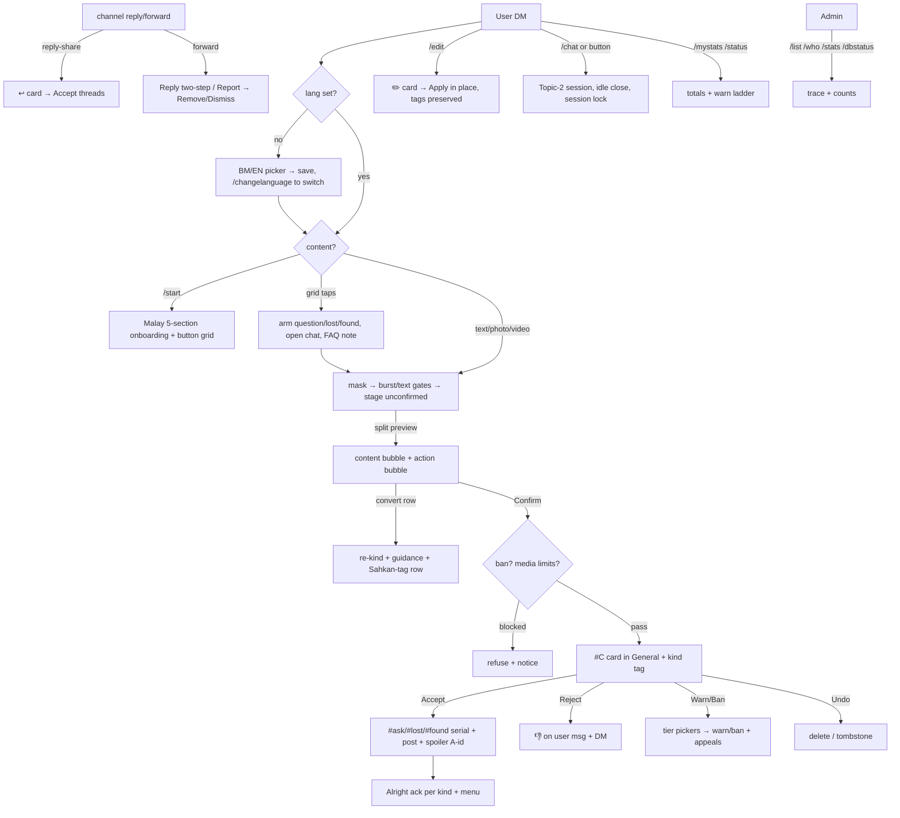

# Just_arobot — feature list

Test bot `@Just_arobot` → promotes to live `@unijaconfession_chatbot` (same code,
different link; needs the live token — BotFather transfer doesn't exist).
Inbox: private group `-1002435146176` General topic. Channel:
`Test Channel` `-1001267775431`. Full history: `plan.md §10`.
Live proof: `stress_test.md`.

## Flow

## Onboarding + language

- First `/start` → BM/EN picker (`users.lang`, migrate applied); later `/start`
  skips to onboarding; `/changelanguage` re-opens it. Existing rows default `ms`.
- Malay 5-section `/start` (prohibitions, FAQ pointer, how-to-send, privacy,
  closing), personalized `Hi {name}`, rich grid: Send Confession | Tanya Soalan /
  Rules | Chat With Admin / Lost & Found. Links parked as plain text.
- All user-DM strings live in `tgcloud/lib/strings.js` (`STR.ms` + `STR.en`,
  128 keys, parity-checked); per-user locale threading, global `LANG` fallback.
  Admin group side stays English; ban/warn voice still English (deferred slice).
- Cancel → preview deleted + compact menu (shared grid helper). Confirm → Alright
  ack per kind (drafts in dict — owner to correct verbatim) + menu.

## Confession intake (confession / `#ask` / `#lost` / `#found`)

- Text / 1 photo / 1 video per message; voice, stickers, documents rejected.
- Sender headers stripped — re-sent, never forwarded.
- **Split preview**: pure-content bubble + labeled action bubble
  (`Mesej diatas ialah *…*` + notes + rows). Confirm/Batal (+ green/red rich
  styles), always-on convert row (`❓ 🔍 📦` + separator pill), chat shortcut
  on heuristic hit (question/lost/found/chat detectors, suggestion-only).
- Gates at Confirm: ban, 1 media/day, 5 texts/hour + 20/day (rolling).
- Contact auto-mask (`[hidden]`, card `stripped: contact`); kill switches
  `MASK_CONTACTS` / `TEXT_LIMITS` / `DRIP_FEED` in config.
- Kinds: `kind` column (`confession/question/lost/found`, legacy `is_question`
  backfills); per-kind serials (`kind_seq` + unique index, `#ask1` fresh from 1,
  race-safe retry); `❓/🔍/📦` cards; `#tag` post leads (edits preserve them).
- Arm intents (`pending_intents` states) for reply/question/lost/found with
  `/cancelreply|/cancelquestion|/cancellostfound`; arm DMs die on cancel
  (`srcMsgId`; pre-push reply rows exempt); session lock blocks new-flow taps
  mid-chat; arming switches (never stacks) with notices; cancels are honest.
- Burst guard (3 msgs/min refused at staging) + tap guard (10 taps/min via
  `hits` table, notice throttled); owner + admins bypass; chat slow-mode removed.

## Anonymity model

- **A-id** (`A0001…`, lazy MAX+1, unique) on all group surfaces — raw tg_id never
  leaves the DB except owner-only `/who` (id, A-id, alias, `#C`). Legacy
  `U-xxxx` aliases still resolve. (The `<tgId>-<A-id>` display was reverted.)
- Channel posts end with a spoiler-tagged A-id (entities-based; edits re-attach).
- `/who` + `/list` (super-admin DM; `/list` also group-admins): totals + `#C`
  history with status sections, 30/page, Seterusnya/Kembali, stateless cursor.

## Admin queue (single General topic, `#C` counter shared)

- Cards: confession / `↩️ Reply` / `🚩 Report` / `✏️ Edit` / `📨 Appeal #A`,
  `❓/🔍/📦` kind tags, `👤 A-id`. First-tap-wins; re-tap idempotent answers.
- **Accept** → post + spoiler A-id + `see the post` link (URL form auto-resolved),
  `Undo` row, per-kind user DM. Republish path for undone cards.
- **Reject** → 👎 reaction on the user's message + Malay DM (falls back to DM-only).
- **Drip-feed parked OFF** (approval-by-hand paces enough): queue code, `/flush`,
  queued counts remain for later.
- **Undo** → delete, tombstone fallback. Every card stamped `by <admin>` (mention).
- `/stats` (pending/queued), `/dbstatus` (table counts + status mix + range),
  `/unbutton` (strip dead keyboards, e.g. retired claim buttons),
  `/synccommands` (autocomplete scopes incl. `/list`, `/changelanguage`),
  `/richprobe` (rich-pipeline probe). `/ban` / `/unban` (reply or id).

## Warn / ban ladder (per channel terms)

- `flood, other` → ringan (warn, 2nd = auto 7d, 3rd = forever);
  `spam, abuse` → sederhana (every warn + auto 20d, 2nd = forever);
  `nsfw, scam` → berat (instant forever, no warning, no appeal).
- 60-day rolling window (audit-derived); duration → tier-labeled reasons →
  alert review → Confirm/Back at every step.
- `/unban` wipes bans + warn slate. Appeals: `/appeal` → Accept (unban) / Reject;
  berat auto-rejected; 1 pending max; both sides notified.

## Replies / reports / reactions / edits / chat

- Admin swipe-reply on cards → anonymous relay (silent OK, unreachable notice
  with A-id). Channel reply-share + cross-chat "Reply in…" → threaded `↩️` cards.
- Forwards → Reply two-step (arm → type, `/cancelreply`) / Report (reasons →
  Remove/Dismiss, both sides notified).
- Reactions mirrored both ways (bot-mirrored, removals too, premium skipped).
- `/edit` → `✏️` card → in-place channel edit (tags re-attached, contacts
  re-masked, media swaps refused, gone-post guidance).
- Topic-2 sessions: user `/chat` / button / admin `/startchat` (busy cap 5,
  30-min idle close, opener markers mapped so reply-to-opener routes, unlinked
  replies get guidance instead of silence).

## Admin access + audit

- Bot-admin = live group admins (`getChatAdministrators`, 60s cache) +
  `ADMIN_IDS` fallback. Every action writes `audit`. Anonymous-admin sends get
  no response (GroupAnonymousBot isn't an admin — send as yourself).
- Rich-vs-inline hybrid: rich-first for look-first surfaces (green/red styles,
  dividers, centered tables — each with plain fallback), pure inline where
  buttons mutate. Rich is platform-bound (dies on any tgcloud exit); inline is
  portable. `docs/rich-messages.md` remains the shape reference.
